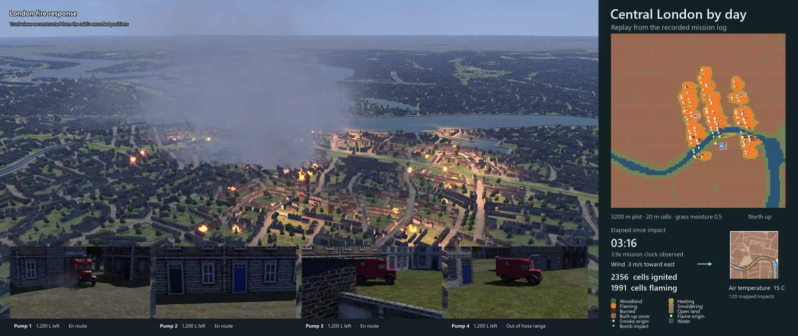
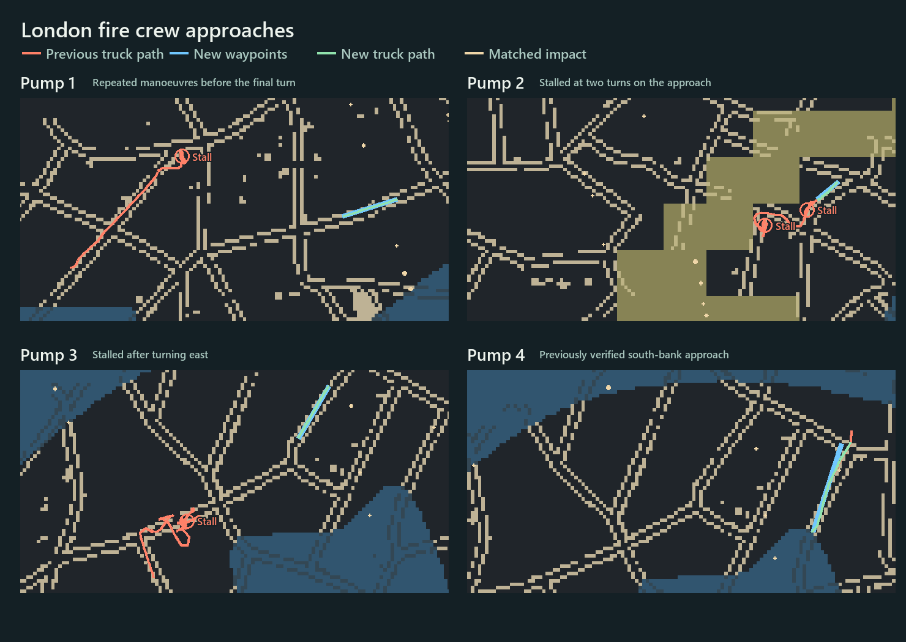
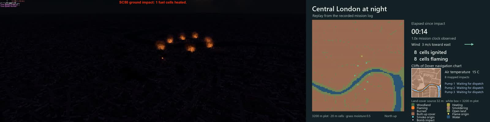

# GroundFire for Cliffs of Dover

GroundFire adds spreading ground fires and a fire crew response to prepared offline missions in **IL-2 Sturmovik: Cliffs of Dover Blitz**. A local Python bridge advances the fire model from the mission clock. The mission script feeds it impacts and truck positions, then updates flames, smoke and lights in CloD.

- [Daylight showcase with the synchronized fire map](https://github.com/phunkaeg/groundfire-clod/releases/download/v0.1.0/london-fire-response-four-truck-showcase-with-map.mp4)
- [Live truck camera from the matched-impact trial](https://github.com/phunkaeg/groundfire-clod/releases/download/v0.1.0/london-matched-live-pump.mp4)
- [Night raid and emissive smoke](https://github.com/phunkaeg/groundfire-clod/releases/download/v0.1.0/london-adaptive-actual-raid-replay.mp4)

The showcase insets were reconstructed from the original run's truck positions. The matched-trial clip follows the live CloD truck at normal game speed.

## Install and fly

This preview was tested in desktop mode on the Steam **vrbeta** branch, menu version **Beta 5.50 build 55**, Steam build **25283265**. Use the matching branch and a Windows installation of Python 3.11 or later with the **py** launcher. Launch CloD once to create its Documents profile.

1. Download and extract [the v0.1.0 package](https://github.com/phunkaeg/groundfire-clod/releases/download/v0.1.0/groundfire-clod-v0.1.0.zip). Keep the folder together.
2. With CloD closed, open PowerShell in the extracted folder and run the installer.

   ~~~powershell
   powershell -NoProfile -ExecutionPolicy Bypass -File .\Install.ps1
   ~~~

   The installer copies mission files into the standard CloD Documents profile. Use **-Profile** with a full path for a redirected Documents folder or a differently named profile. Add **-DryRun** to see the planned copies.
3. Open **Launch Day Bridge.cmd** and leave its window open.
4. In CloD, open **Single Player → Single Mission**, then choose one of the GroundFire missions below. After entering flight, use CloD's autopilot binding if you want the aircraft to keep flying while you watch the camera. The script selects the London camera once the mission is running.

| Mission | What you can observe |
| --- | --- |
| **GroundFire London Live Raid** | Live AI bomb impacts start fires. The aerial camera shows spread, separated flames and smoke, and district lights. Live impact scatter can place fires outside hose range. |
| **GroundFire London Matched Crew Trial** | Each run receives the same 119 accepted impact records. The camera switches to Pump 1 at dispatch. CloD steers the four trucks live. The replay reproduces ignition inputs only. |
| **GroundFire London Night Glow** | The optional night version uses brighter red-orange smoke near the fire and a fade as the particles rise. |

For the optional night mission, close the day bridge and install the night files using your CloD installation directory.

~~~powershell
powershell -NoProfile -ExecutionPolicy Bypass -File .\Install.ps1 -Night -GameDirectory "D:\SteamLibrary\steamapps\common\IL-2 Sturmovik Cliffs of Dover Blitz"
~~~

Use **Launch Night Bridge.cmd** for **GroundFire London Night Glow**. The installer obtains the smoke-sprite atlas from your local game archive. An already exported copy can be supplied with **-SmokeAtlas**. The package carries the custom effects and material definitions.

## What the preview models

- A 3.2 km × 3.2 km London plot with 20 m cells. The solver tracks heat, fuel, moisture, wind-biased spread, smoldering and burnout.
- Separate flame and smoke emitters, bounded district lights, and a red-orange emissive smoke layer that fades with particle age. The visible glow uses CloD's particle material pipeline.
- Four Austin K2 trucks with a setup delay, a 170 m hose limit and a simulated 1,200 L supply each. The bridge applies water only after a truck stops within range of burning fuel.

The fuel map is a terrain classification with estimated fuel properties. The camera, managed game bindings and crew paths are specific to the tested build and missions. The preview supports offline single player. City-wide dynamic rerouting, multiplayer synchronization and persistent terrain scars remain research items.

## Road trials

The first layout sent trucks into repeated turns and reversing manoeuvres. The revised layout uses four short approaches checked against CloD's street data. Its live test used the same impacts, at the same relative times, as the control.

| Routes | Crews that reached a stop and pumped | Water applied over the first 331 mission seconds |
| --- | ---: | ---: |
| Prior street routes | 2 of 4 | 1,217 L |
| Revised approaches | 4 of 4 | 4,800 L |

## Source and verification

- [Fire model](firesim/) and [CloD integration](integrations/clod/)
- [Matched impact and route data](terrain/) and [mission files](missions/)
- [Smoke material, lifetime ramps and road troubleshooting](docs/implementation.md)

Run the offline tests.

~~~powershell
py -3 -m pip install -r requirements-visual.txt
py -3 -B -m unittest discover -s tests
~~~

GroundFire is an independent prototype for use with your own CloD installation.
